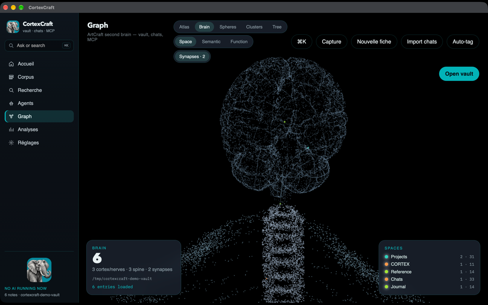

# CortexCraft

[](LICENSE)
[](CODE_OF_CONDUCT.md)

Local-first **second brain** for an [Obsidian](https://obsidian.md) vault: 3D graph, notes, imports, MCP for agents, optional Claude Code headless via an external keeper.

> Phase 1 scope: local record + exploration. No cloud account, no multi-device sync.

## Community

| Resource | Link |
| -------- | ---- |
| Contributing | [CONTRIBUTING.md](CONTRIBUTING.md) |
| Code of Conduct | [CODE_OF_CONDUCT.md](CODE_OF_CONDUCT.md) |
| Security | [SECURITY.md](SECURITY.md) |
| Support | [SUPPORT.md](SUPPORT.md) |
| Roadmap | [docs/ROADMAP.md](docs/ROADMAP.md) |
| License | [MIT](LICENSE) |

## Features (Phase 1)

- Obsidian vault scan + live revision poll
- Anatomical 3D cortex (layouts, group-by, `[[wikilink]]` synapses)
- Capture (daily), new note, Markdown edit with version backups
- Command palette / Ask (`⌘K`)
- Chat & external imports (Apple Notes/Health, markdown exports, …)
- Analyses (tables / waves)
- Local settings + first-run setup (profile, vault, nomenclature)
- Optional bridge to `vault-pipeline` keeper (Claude Code `claude -p`)
- CLI MCP server (`cortexcraft mcp`)

## User guide

- **[docs/USAGE.md](docs/USAGE.md)** — à quoi ça sert, ce qui marche, comment s’en servir
- **[docs/recipes/](docs/recipes/README.md)** — 10 recettes pas à pas
- **[docs/screenshots/](docs/screenshots/README.md)** — captures UI (vault démo)



## Download

**[Release v0.1.0](https://github.com/ROSITO/CortexCraft/releases/tag/v0.1.0)** — macOS Apple Silicon DMG (`CortexCraft_0.1.0_aarch64.dmg`).

Unsigned / not notarized yet: on first open use **Privacy & Security → Open Anyway** if Gatekeeper blocks it. Intel Mac builds are not included in this release.

## Quick start (from source)

### Prerequisites

- macOS (primary)
- Node.js 20+, Rust stable, [Tauri 2 prerequisites](https://v2.tauri.app/start/prerequisites/)

```bash
git clone https://github.com/ROSITO/CortexCraft.git
cd CortexCraft
npm install
npm run tauri dev
```

On first launch: display name + Obsidian vault folder. Claude headless is optional.

### CLI / MCP

```bash
cargo build -p cortexcraft --bin cortexcraft --manifest-path src-tauri/Cargo.toml

./src-tauri/target/debug/cortexcraft mcp --vault /path/to/your/obsidian/vault
./src-tauri/target/debug/cortexcraft scan --vault /path/to/your/obsidian/vault
```

Cursor MCP example (put `cortexcraft` on your `PATH`):

```json
{
  "mcpServers": {
    "cortexcraft": {
      "command": "cortexcraft",
      "args": ["mcp", "--vault", "/path/to/your/obsidian/vault"]
    }
  }
}
```

### Vault layout

`CORTEX/` is reserved for notes **written by** CortexCraft (`versions/`, `daily/`, …). Bring-in sources use root folders (`Apple Notes/`, `Health/`, `Chats/`, …).

## Architecture notes

- **Settings**: `craft-settings` (`APP_ID=cortexcraft`)
- **Flags**: `craft-flags` under the ArtCraft support directory when present
- **Dependencies**: `craft-libs` git pin in `src-tauri/Cargo.toml` — see [CONTRIBUTING.md](CONTRIBUTING.md)

## Status

**Phase 1 complete** for local use: vault → graph → notes → search → imports → analyses → MCP → optional keeper. Verified with `npm run build`, `cargo test` (13 pass / 1 ignored live Notes), and UI smoke on a demo vault.

Cold clone may still need access to the `craft-libs` git pin (see CONTRIBUTING). Keeper / Claude headless remain optional and external.

## License

MIT — see [LICENSE](LICENSE).
